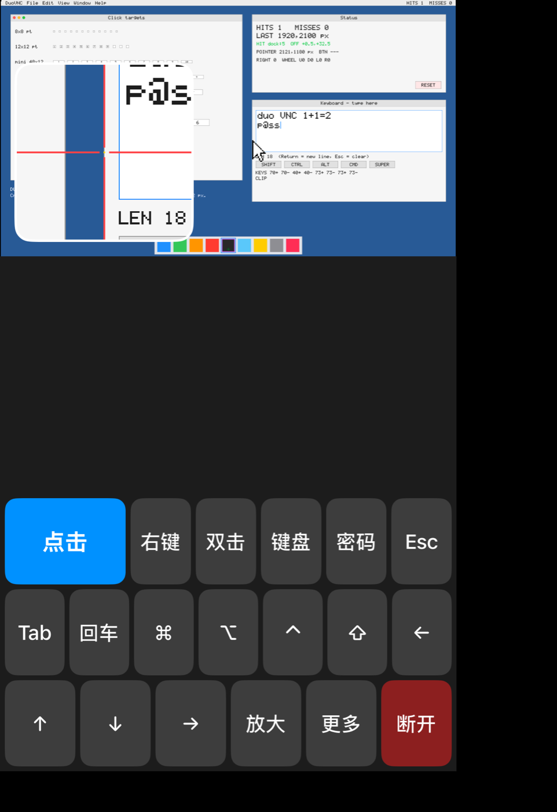

# iPhone Duo VNC

A VNC client for the foldable iPhone Duo, made for one job: briefly taking over a Mac through the
Screen Sharing server built into macOS. Tap the right button, type a password, leave.



- **macOS account login** (Apple's type 33 scheme), with the server key pinned on first use.
- **Aim, then click**: drag moves a local cursor under a loupe; nothing is clicked until you press 点击.
- **Passwords** go through a secure field and are sent as key presses, never via the clipboard.
- **Foldable layout**: the strip a 16:9 desktop leaves empty becomes the toolbar; folding keeps the session.
- **Demo mode** works offline against a built-in fake server.

## Status

A personal project, not on the App Store; the interface is in Simplified Chinese. It runs on a real
iPhone Duo against macOS 27 over Tailscale, and the protocol code has 356 tests. VNC-password and
Apple Remote Desktop logins, the clipboard, and cellular performance are untested against a real Mac.
Most of the code was written by AI agents (Claude) directed and tested by the author.

Only the login is encrypted; the session is plain RFB. Use it over Tailscale or another private
tunnel, never over the open internet.

## Build

Needs Xcode 27.1+, [XcodeGen](https://github.com/yonaskolb/XcodeGen), an Apple ID (a free one works,
renewed every 7 days) and an iPhone Duo in Developer Mode.

```sh
cp App/Signing.xcconfig.example App/Signing.xcconfig   # set DEVELOPMENT_TEAM
zsh scripts/install-device.sh
scripts/test.sh                                        # package tests, no simulator needed
```

More: [App/README.md](App/README.md) for building and installing, and
[docs/macos-screen-sharing-notes.md](docs/macos-screen-sharing-notes.md) for what macOS Screen Sharing
actually does on the wire.

## Credits and license

MIT ([LICENSE](LICENSE)). Parts of the login code follow [TailVNC](https://github.com/Sancerio/tailvnc)
and [RoyalVNC](https://github.com/royalapplications/royalvnc), both MIT; see
[THIRD_PARTY_NOTICES.md](THIRD_PARTY_NOTICES.md). VNC is a trademark of RealVNC Ltd; iPhone and macOS
are trademarks of Apple Inc. Not affiliated with either.
