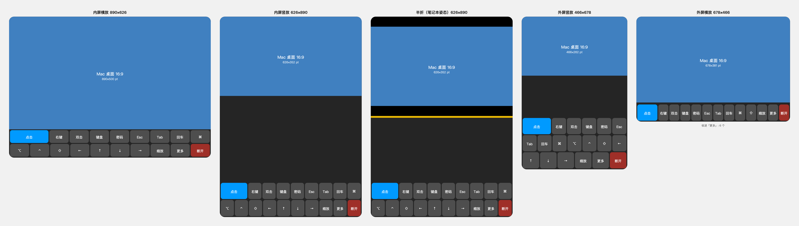

# iPhone Duo VNC

A VNC client for the foldable iPhone Duo, built for one job: briefly taking over a Mac through the
Screen Sharing server that ships with macOS. Tap the right button, type a password, leave. On the home
screen the app is called "Duo VNC".


## What it does

- **Logs in with a macOS account** (Apple's RSA/AES scheme, security type 33), so no VNC password has
  to be enabled on the Mac. The server's key is pinned on first use.
- **Aim, then click.** A finger is far bigger than a 24-point macOS button. Dragging moves a locally
  drawn cursor under a loupe; nothing is clicked until you press the 点击 button. Zoom in past a
  threshold and a tap clicks directly.
- **Passwords go through a secure field**, are sent as key presses only when you confirm, and never
  touch the remote clipboard or a log.
- **Uses the space a foldable has.** The Mac's 16:9 desktop never fills a 1.4:1 screen, so the leftover
  strip becomes the toolbar instead of black bars. Folding and unfolding only changes the layout; the
  session stays up.
- **Demo mode** runs against a built-in fake server, offline, with small click targets and a typing
  area for trying the gestures.



## Status

A personal project that works for its author. It is not on the App Store; you build and install it
yourself. The interface is in Simplified Chinese.

Verified:

- Unit and end-to-end tests of the protocol code, 356 tests, run with `scripts/test.sh`.
- Against a real Mac (macOS 27.0.1): account login, ZRLE frames, clicking, typing mixed-case text and
  symbols, modifier keys. See [docs/macos-screen-sharing-notes.md](docs/macos-screen-sharing-notes.md).
- The app builds with Xcode 27.2, runs in the iPhone Duo simulator and on a real iPhone Duo, where it
  connects to a Mac over Tailscale.

Not verified, or known to be rough:

- VNC-password login (type 2) and Apple Remote Desktop login (type 30) are implemented and
  unit-tested but have not been run against a real server.
- Clipboard, display changes during a session, and long sessions.
- The portrait layouts leave an empty band between the desktop and the toolbar.
- Performance over cellular. macOS does not offer Tight/JPEG, so a full 4K frame is several megabytes.

## Security model

Only the login is encrypted. After that, the screen and your keystrokes travel as plain RFB, exactly
as with every other client of this server. Use it over a private tunnel such as Tailscale or
WireGuard, and never expose port 5900 to the internet. The app warns before connecting to a plain LAN
address and refuses public addresses.

## Build and install

Requirements: a Mac with Xcode 27.1 or later, [XcodeGen](https://github.com/yonaskolb/XcodeGen)
(`brew install xcodegen`), an Apple ID (a free one works; the install then has to be renewed every
7 days), and an iPhone Duo in Developer Mode.

```sh
cp App/Signing.xcconfig.example App/Signing.xcconfig   # then set DEVELOPMENT_TEAM
zsh scripts/install-device.sh
```

Details, simulator instructions and the first-launch steps on the phone are in
[App/README.md](App/README.md).

## Repository layout

| Path | What |
| --- | --- |
| `Sources/RFBBase` | shared types, byte streams, framebuffer, decoder and security contracts |
| `Sources/RFBSecurity` | security types 1, 2, 30, 33 |
| `Sources/RFBDecoders` | Raw, CopyRect, RRE, Hextile, Zlib, ZRLE, Tight |
| `Sources/RFBClient` | TCP transport and the client state machine |
| `Sources/RFBCore` | umbrella module with the default wiring |
| `Sources/RFBMockServer` | fake server with encoders, used by tests and by demo mode |
| `Sources/DuoVNCKit` | UIKit-free app logic: viewport, pointer engine, key mapping, layout, host policy |
| `Sources/DuoVNCSession` | connection lifecycle, reconnect, host-key trust, input pacing |
| `Sources/rfbprobe` | command-line probe: handshake, statistics, frame to PNG |
| `App/` | the iOS app (SwiftUI host list, UIKit and Metal session screen) |
| `tools/` | `rfbctl` (scripted clicks and typing against a server), `layoutpreview` |

The Swift package has no third-party dependencies and builds on macOS, so everything except the UI
layer is tested without a simulator:

```sh
scripts/test.sh
swift run rfbprobe <host>                              # version and security types, no login
swift run rfbprobe <host> --env-file .test-account.env --png frame.png
```

`scripts/setup-test-account.sh` creates a throwaway macOS account for such tests, so they never need a
real account's password.

## Credits

The type 33 credential packaging is ported from [TailVNC](https://github.com/Sancerio/tailvnc), and the
type 30 exchange follows [RoyalVNC](https://github.com/royalapplications/royalvnc); both are MIT
licensed. See [THIRD_PARTY_NOTICES.md](THIRD_PARTY_NOTICES.md).

VNC is a trademark of RealVNC Ltd. iPhone and macOS are trademarks of Apple Inc. This project is not
affiliated with either company.

## License

MIT. See [LICENSE](LICENSE).
